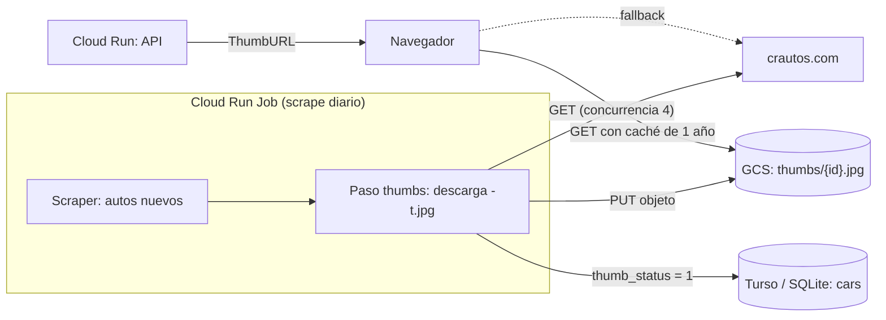
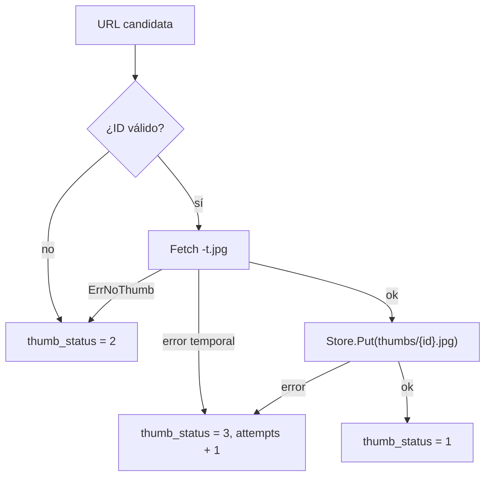

# Fotos – Fase 2: miniaturas en Cloud Storage

Plan de implementación para guardar las miniaturas de los anuncios en Google Cloud Storage (GCS), para que no se pierdan cuando Crautos borra el anuncio.
Viene de la sección "📷 Fotos – Fase 2" de [ux-improvements.md](./ux-improvements.md).

Estado: **pendiente**. Antes de empezar hay que cerrar el [Paso 0 (derechos)](#paso-0--antes-de-empezar-derechos-y-decisiones).

Última actualización: 2026-11-11

---

## 1. Problema

Hoy las fotos se cargan directo de Crautos y las URLs se arman a partir del ID del anuncio (`web/src/utils/carPhotos.js`):

| Foto | URL | Tamaño |
|---|---|---|
| Miniatura | `https://crautos.com/clasificados/usados/{id}-t.jpg` | 150×113, ~4.5 KB |
| Foto grande | `https://crautos.com/clasificados/usados/{id}-{n}.jpg` (n = 1..N) | 750×565, ~60 KB |

Problemas:
1. **Se pierden.** Cuando Crautos borra el anuncio desaparecen las fotos. Eso afecta justo a los autos vendidos (Estadísticas, historial, Favoritos viejos), que son la mayor parte del catálogo: con los datos locales hay **10,336 autos, de los que 6,697 están activos**.
2. **Cargan lento.** Crautos responde `Cache-Control: no-cache`, así que el navegador vuelve a pedir cada miniatura.
3. **Dependencia.** Si Crautos bloquea el uso desde otros sitios (hotlinking), dejan de verse. **Esa decisión se respeta:** nunca se intenta saltar un bloqueo (cambiar el `Referer`, usar un proxy, etc.).

Una foto que no existe responde **200 con `Content-Type: text/html`**, no 404. Siempre hay que validar el tipo de contenido.

## 2. Objetivo y alcance

- **Sí:** guardar **solo la miniatura** (`-t.jpg`) de cada anuncio en GCS, una vez, y servirla desde ahí con caché larga.
- **No:** las fotos grandes ni la galería. Se siguen cargando de Crautos mientras existan; si no existen, se usa la miniatura guardada o la silueta.
- **No:** proxy de imágenes en el backend.

Tamaño estimado: ~10.5k autos × 4.5 KB ≈ **47 MB**, más unos 300–500 anuncios nuevos por semana.

## Paso 0 – Antes de empezar: derechos y decisiones

> [!IMPORTANT]
> Las fotos son de los vendedores o de Crautos. Guardar copias es distinto a enlazarlas.

- [ ] Revisar los términos de uso de Crautos sobre las imágenes, o pedir permiso por escrito. Si no lo permiten, **no se implementa** esta fase y se queda la silueta de respaldo.
- [ ] Mantener siempre el botón "Ver en Crautos" y no quitar marcas de agua (la miniatura se guarda tal cual, sin modificarla).
- [ ] Definir cómo atender un pedido de retiro (vendedor o Crautos): borrar el objeto y marcar el auto (ver [Retiro de una foto](#retiro-de-una-foto)).
- [ ] Confirmar el nombre del bucket y la región (propuesta abajo).

---

## 3. Arquitectura



- La descarga corre en el **job diario de scraping** (`crautosdb-scrape-daily`), después de procesar las marcas, para atrapar los anuncios nuevos antes de que se vendan.
- El navegador pide la miniatura **directo al bucket público**. El API solo agrega `ThumbURL` al JSON.
- Si algo falla (no hay bucket configurado, objeto inexistente), el frontend vuelve a la URL de Crautos y luego a la silueta, como hoy.

## 4. Infraestructura (GCP)

Proyecto y región actuales: los de `deploy_gcp.ps1` (`us-central1`).

### 4.1 Bucket

| Parámetro | Valor | Por qué |
|---|---|---|
| Nombre | `crautosdb-thumbs` (o `<project-id>-thumbs` si está tomado) | Los nombres de bucket son globales. |
| Región | `us-central1` | La misma que Cloud Run; entra en la capa gratuita. |
| Clase | Standard | Lecturas frecuentes. |
| Acceso | Uniform bucket-level access | Permisos solo a nivel de bucket, sin ACL por objeto. |
| Lectura pública | `allUsers` → `roles/storage.objectViewer` **solo en este bucket** | El navegador carga la imagen sin firmar URLs. |
| Prevención de acceso público | Desactivada **solo en este bucket** | Necesaria para lo anterior. |
| Versionado | Apagado | No hace falta. |
| Ciclo de vida | Ninguno al inicio (ver [Opcional](#9-opcional--después)) | Las miniaturas de vendidos son justo lo que queremos guardar. |

```powershell
$PROJECT_ID = "<project-id>"
$BUCKET     = "crautosdb-thumbs"
$REGION     = "us-central1"

gcloud services enable storage.googleapis.com
gcloud storage buckets create gs://$BUCKET --project=$PROJECT_ID --location=$REGION `
  --default-storage-class=STANDARD --uniform-bucket-level-access
gcloud storage buckets update gs://$BUCKET --no-public-access-prevention
gcloud storage buckets add-iam-policy-binding gs://$BUCKET `
  --member=allUsers --role=roles/storage.objectViewer
```

URL pública de un objeto: `https://storage.googleapis.com/crautosdb-thumbs/thumbs/{id}.jpg`

### 4.2 Permisos de escritura

Hoy los jobs corren con la cuenta de servicio por defecto de Compute (`<project-number>-compute@developer.gserviceaccount.com`). Opciones:

- **Mínimo:** darle a esa cuenta `roles/storage.objectCreator` **solo sobre el bucket** (crear objetos, no borrar ni listar).
- **Recomendado:** crear una cuenta propia para los jobs (`crautosdb-scraper@…`) con ese mismo rol, y pasarla con `--service-account` en `gcloud run jobs deploy`.

```powershell
$SA = "<project-number>-compute@developer.gserviceaccount.com"   # o la cuenta propia
gcloud storage buckets add-iam-policy-binding gs://$BUCKET `
  --member="serviceAccount:$SA" --role=roles/storage.objectCreator
```

> [!NOTE]
> `objectCreator` no permite sobrescribir un objeto existente. Eso está bien, porque las miniaturas no se reemplazan. Si más adelante se quiere refrescarlas, hace falta `roles/storage.objectUser`.

El **servicio web no necesita permisos** sobre el bucket: solo arma la URL pública.

### 4.3 Variables de entorno

| Variable | Dónde | Ejemplo | Efecto |
|---|---|---|---|
| `THUMBS_BUCKET` | Jobs de scraping | `crautosdb-thumbs` | Si está vacía, el paso de miniaturas se salta (local y entornos sin GCS). |
| `THUMBS_PUBLIC_BASE` | Servicio web | `https://storage.googleapis.com/crautosdb-thumbs/thumbs` | Si está vacía, el API no envía `ThumbURL`. |

Agregarlas en `deploy_gcp.ps1`: en los dos `gcloud run jobs deploy` y en `gcloud run deploy`.

### 4.4 Costos estimados

Precios de lista de GCS en `us-central1` (verificar en la página de precios antes de empezar):

| Concepto | Volumen | Costo aprox. |
|---|---|---|
| Almacenamiento | ~50 MB | Dentro de la capa gratuita (5 GB-mes en `us-central1`). |
| Subidas (operaciones clase A) | ~10.5k en el backfill y ~2k al mes después | Backfill ≈ \$0.05; mensual dentro de la capa gratuita (5k). |
| Lecturas (clase B) | 1 por miniatura y navegador gracias a la caché | 50k/mes gratis; después ≈ \$0.004 por 10k. |
| Salida de red | 1M de miniaturas vistas ≈ 4.5 GB | Dentro de la capa gratuita (100 GB/mes desde Norteamérica); después ≈ \$0.12/GB. |

Conclusión: unos pocos centavos al mes con el tráfico actual.

---

## 5. Base de datos

### 5.1 Columnas nuevas en `cars`

| Columna | Tipo | Default | Significado |
|---|---|---|---|
| `thumb_status` | INTEGER | 0 | 0 = pendiente, 1 = guardada en GCS, 2 = no existe en Crautos, 3 = falló (se reintenta) |
| `thumb_checked_at` | DATETIME / TIMESTAMP | NULL | Último intento. |
| `thumb_attempts` | INTEGER | 0 | Intentos fallidos (estado 3). Después de 5 se deja de intentar. |

Índice para el paso de miniaturas: `CREATE INDEX IF NOT EXISTS idx_cars_thumb ON cars(thumb_status, is_sold);`

### 5.2 Migración (`db/db.go`)

Sigue el patrón existente:
- **SQLite / libsql:** agregar a la lista de `ALTER TABLE cars ADD COLUMN …` (los errores de "columna ya existe" se ignoran):
  - `ALTER TABLE cars ADD COLUMN thumb_status INTEGER DEFAULT 0`
  - `ALTER TABLE cars ADD COLUMN thumb_checked_at DATETIME`
  - `ALTER TABLE cars ADD COLUMN thumb_attempts INTEGER DEFAULT 0`
- **Postgres:** las mismas con `ADD COLUMN IF NOT EXISTS` (y `TIMESTAMP` en lugar de `DATETIME`).
- Agregar las columnas también al `CREATE TABLE cars` para bases nuevas, y el índice junto a los demás `CREATE INDEX`.

> [!WARNING]
> `UpsertCar` y `UpsertCarBatch` **no deben tocar** estas columnas. Hoy no lo harían, porque el `INSERT … ON CONFLICT DO UPDATE` lista sus columnas explícitamente. No hay que agregarlas ahí: un re-scrape del anuncio no debe borrar el estado de la miniatura.

### 5.3 Funciones nuevas (`db/thumbs.go`)

```go
// Estados de thumb_status.
const (
	ThumbPending  = 0
	ThumbStored   = 1
	ThumbMissing  = 2 // Crautos respondió text/html: el anuncio no tiene miniatura
	ThumbFailed   = 3 // error de red / GCS; se reintenta
	MaxThumbTries = 5
)

// ThumbCandidates devuelve hasta limit URLs de anuncios que necesitan miniatura:
// primero los activos pendientes (más recientes primero) y luego los fallidos
// con menos de MaxThumbTries intentos y sin intento en las últimas 24 h.
func (d *DB) ThumbCandidates(limit int) ([]string, error)

// SetThumbStatus guarda el resultado de un intento (actualiza thumb_checked_at,
// y suma thumb_attempts cuando status == ThumbFailed).
func (d *DB) SetThumbStatus(url string, status int) error
```

Consulta de `ThumbCandidates` (SQLite; con `queryFormat` para los demás drivers):

```sql
SELECT url FROM cars
WHERE (thumb_status = 0 AND is_sold = 0)
   OR (thumb_status = 3 AND thumb_attempts < 5
       AND (thumb_checked_at IS NULL OR thumb_checked_at < datetime('now', '-1 day')))
ORDER BY CASE WHEN thumb_status = 0 THEN 0 ELSE 1 END, scraped_at DESC
LIMIT ?
```

Los autos **ya vendidos y pendientes** se excluyen del paso diario: lo más probable es que Crautos ya borró la foto. Se intentan una sola vez en el backfill (sección 7).

### 5.4 Lectura en el API

- Agregar `ThumbStatus int` al struct `Car` (`db/queries.go`) y leer `COALESCE(thumb_status, 0)` en **todas** las consultas que hacen `Scan` de un `Car` completo: `GetCars` y `GetCarsByURLs` (además de la migración a Supabase de `main.go`, que usa `GetCars`).
- No exponer `ThumbStatus` en el JSON; exponer `ThumbURL` (siguiente sección).

---

## 6. Backend

### 6.1 Abstracción de almacenamiento (`thumbs/store.go`)

Paquete nuevo `thumbs`, con una interfaz para poder probar sin GCS:

```go
package thumbs

type Store interface {
	// Put guarda data en key. Si el objeto ya existe no es un error (idempotente).
	Put(ctx context.Context, key string, data []byte) error
}

// Key devuelve la ruta del objeto para un ID de anuncio.
func Key(carID string) string { return "thumbs/" + carID + ".jpg" }
```

Implementación GCS (`thumbs/gcs.go`) con la librería oficial `cloud.google.com/go/storage`. Usa Application Default Credentials: en Cloud Run, la cuenta de servicio del job; en local, `gcloud auth application-default login`.

```go
type GCSStore struct {
	bucket *storage.BucketHandle
}

func NewGCSStore(ctx context.Context, bucket string) (*GCSStore, error) {
	c, err := storage.NewClient(ctx)
	if err != nil {
		return nil, err
	}
	return &GCSStore{bucket: c.Bucket(bucket)}, nil
}

func (s *GCSStore) Put(ctx context.Context, key string, data []byte) error {
	// DoesNotExist: no sobrescribe y lo hace idempotente (412 = ya existe).
	w := s.bucket.Object(key).If(storage.Conditions{DoesNotExist: true}).NewWriter(ctx)
	w.ContentType = "image/jpeg"
	w.CacheControl = "public, max-age=31536000, immutable"
	w.ChunkSize = 0 // objeto chico: una sola petición
	if _, err := w.Write(data); err != nil {
		w.Close()
		return err
	}
	if err := w.Close(); err != nil {
		var gerr *googleapi.Error
		if errors.As(err, &gerr) && gerr.Code == http.StatusPreconditionFailed {
			return nil // ya existía
		}
		return err
	}
	return nil
}
```

Para los tests: `MemStore` (un `map[string][]byte` con mutex) en `thumbs/store_test.go`.

> [!NOTE]
> `cloud.google.com/go/storage` agrega varias dependencias (gRPC, OAuth). El binario crece unos MB, pero es la vía oficial y maneja credenciales y reintentos. La alternativa sin dependencias (JSON API por HTTP y token del metadata server) no vale la pena para esto.

### 6.2 Descarga y validación (`thumbs/fetch.go`)

```go
var ErrNoThumb = errors.New("listing has no thumbnail")

// Fetch descarga la miniatura de Crautos y valida que sea un JPEG real.
func Fetch(ctx context.Context, client *http.Client, carID string) ([]byte, error)
```

Reglas:
1. `GET https://crautos.com/clasificados/usados/{id}-t.jpg`, con timeout de 15 s (el del `http.Client` del scraper) y el mismo `User-Agent`.
2. Status distinto de 200 → error **temporal** (estado 3).
3. `Content-Type` que no empieza con `image/` → `ErrNoThumb` (estado 2). Así se detecta la página HTML que Crautos devuelve cuando no hay foto.
4. Cuerpo leído con `io.LimitReader(resp.Body, 200<<10)` (200 KB como máximo).
5. Validar los **bytes mágicos** de JPEG (`FF D8 FF`) y un tamaño mínimo (> 500 bytes). Si no cumple → `ErrNoThumb`.
6. Si el servidor responde 403 o 429 de forma repetida: **detener el paso** (no reintentar en bucle). Es una señal de que Crautos no quiere estas descargas; se registra en el log y se revisa a mano.

El ID sale de la URL del anuncio con la misma regla que el frontend (`[?&]c=(\d+)`). Hay que moverla a una función Go (`thumbs.CarID(url)`) con su test.

### 6.3 Paso de miniaturas (`thumbs/runner.go`)

```go
type Runner struct {
	DB      *db.DB
	Store   Store
	Client  *http.Client
	Workers int           // 4
	Delay   time.Duration // 250 ms entre descargas por worker
}

// Run procesa hasta limit candidatos y devuelve un resumen.
func (r *Runner) Run(ctx context.Context, limit int) (Summary, error)

type Summary struct{ Stored, Missing, Failed, Skipped int }
```

Flujo por anuncio:



- Concurrencia **baja y fija** (4 workers con una pausa de 250 ms): unas 16 descargas por segundo como máximo, muy por debajo de lo que ya hace el scraper (15 workers).
- `ctx` con límite de tiempo: el paso no debe comerse el `--task-timeout` del job. Darle como máximo **10 minutos** en el job diario.
- Log al final: `Thumbs: stored=… missing=… failed=… in …s`.

### 6.4 Integración con el scraper y flags (`main.go`)

- Flag nuevo `-thumbs` (default `true`): al terminar `s.Run()`, si `THUMBS_BUCKET` está definida, corre `Runner.Run(ctx, 2000)`.
- Flag nuevo `-backfill-thumbs`: corre solo el paso de miniaturas sobre **todos** los candidatos, incluidos los vendidos pendientes (sección 7), y termina.
- Si `THUMBS_BUCKET` está vacía, el paso se salta con un log `Thumbs: disabled (THUMBS_BUCKET not set)`.

### 6.5 API

- En `api/market.go` (`CarWithMarket`, que ya envuelve a todos los autos que devuelve el API) o en un envoltorio común, agregar:

```go
ThumbURL string `json:"ThumbURL,omitempty"`
```

  con valor `THUMBS_PUBLIC_BASE + "/" + id + ".jpg"` **solo si** `ThumbStatus == 1` y la variable está definida.
- Revisar que **todas** las respuestas con autos pasen por ese envoltorio: `/api/cars`, `/api/cars/favorites`, `/api/bargains` y las herramientas del Copilot que devuelven autos.

---

## 7. Backfill inicial

Una sola vez, después de desplegar el código y crear el bucket:

```powershell
gcloud run jobs execute crautosdb-scrape-daily --region us-central1 `
  --args="-serve=false,-scrape=false,-backfill-thumbs=true" --wait
```

(También se puede correr en local con `THUMBS_BUCKET` y `gcloud auth application-default login`, apuntando `DATABASE_URL` a Turso.)

- Candidatos del backfill: **todos** los `thumb_status = 0`, activos primero y después vendidos (los vendidos muy probablemente terminen en estado 2, pero vale la pena un intento).
- Tiempo estimado: ~10.5k anuncios ÷ (4 workers × ~3/s) ≈ **15 minutos**. Si el job tiene `--task-timeout 1800s`, alcanza; si no, correrlo dos veces (es idempotente).
- Verificación: `SELECT thumb_status, COUNT(*) FROM cars GROUP BY thumb_status;`

---

## 8. Frontend

### 8.1 `web/src/utils/carPhotos.js`

- `getThumbUrl(url)` pasa a `getThumbUrl(car)`, que devuelve `car.ThumbURL` si existe y si no la URL de Crautos. Hay que actualizar sus usos en `CarPhoto.jsx`.
- Nueva función `getThumbCandidates(car, variant)` que devuelve la cadena de respaldo:

| Variante | Auto activo | Auto vendido |
|---|---|---|
| `table` / `mobile` | `ThumbURL` → Crautos `-t` → silueta | `ThumbURL` → silueta |
| `card` | Crautos `-1` → `ThumbURL` → Crautos `-t` → silueta | `ThumbURL` → silueta |

  En vendidos no tiene sentido pedir a Crautos (la foto ya no existe y cada intento fallido es una petición perdida).

### 8.2 `CarPhoto.jsx`

- `CarThumb` arma `candidates` con `getThumbCandidates`. El resto de la cadena (`onError` → siguiente, shimmer, silueta) queda igual.
- La vista previa al pasar el mouse y la galería del modal siguen usando las fotos grandes de Crautos. Si fallan, la galería muestra la miniatura guardada (agrandada) en lugar de un hueco.
- En tarjetas, la miniatura de 150×113 se ve borrosa a ancho completo. Mientras el anuncio exista, se prefiere la `-1` de Crautos (como hoy).

### 8.3 Sin cambios

`MAX_GALLERY_PHOTOS`, las siluetas por `Estilo` y el interruptor "Con fotos / Compacta".

---

## 9. Opcional – después

- **Imagen mediana para tarjetas** de autos vendidos: guardar también `-1.jpg` redimensionada a ~400 px (~25 KB). Unos 260 MB para todo el catálogo. Solo si las tarjetas de vendidos se ven mal.
- **`photo_count`**: contar las fotos con `HEAD` (`-1`, `-2`, … hasta que el `Content-Type` sea `text/html`) para que la galería no tenga que probar una por una. Cuidado con la cantidad de peticiones a Crautos.
- **Ciclo de vida**: borrar automáticamente las miniaturas con más de 2–3 años (regla de lifecycle por edad). El frontend ya cae a la silueta si el objeto no existe.
- **Dominio propio / CDN** (`img.<dominio>` con Cloud CDN): solo si el tráfico crece mucho.

---

## 10. Pruebas

| Qué | Cómo |
|---|---|
| `thumbs.CarID` | Test de tabla con URLs reales, sin `c=` y con parámetros extra. |
| `thumbs.Fetch` | `httptest.Server` que responde: JPEG válido; 200 `text/html` (→ `ErrNoThumb`); 500 (→ temporal); JPEG truncado de 100 bytes (→ `ErrNoThumb`); cuerpo de 5 MB (se corta en 200 KB). |
| `Runner.Run` | SQLite temporal + `MemStore` + `httptest.Server`: los estados terminan en 1/2/3, `thumb_attempts` sube, un segundo `Run` no vuelve a procesar los guardados, y respeta `limit` y el `ctx` cancelado. |
| Migración | Abrir una base vieja (sin las columnas) y verificar que `Init` las agrega y que `UpsertCar` no cambia `thumb_status`. |
| `ThumbCandidates` | Orden (activos pendientes antes que fallidos), exclusión de vendidos pendientes, máximo de intentos y espera de 24 h. |
| API | `ThumbURL` presente solo con `thumb_status = 1` y `THUMBS_PUBLIC_BASE` definida. |
| Frontend | Manual: tabla y tarjetas con un auto con `ThumbURL`, uno sin ella y uno vendido; bloquear `storage.googleapis.com` en DevTools y verificar que cae a Crautos y luego a la silueta. |

## 11. Despliegue y reversa

Orden:
1. Paso 0 (derechos) aprobado.
2. Crear el bucket y los permisos (sección 4).
3. Desplegar backend y frontend con `THUMBS_BUCKET` en los jobs y **sin** `THUMBS_PUBLIC_BASE` en el servicio. Así el código nuevo corre, pero el sitio sigue usando Crautos.
4. Ejecutar el backfill (sección 7) y revisar los conteos por estado.
5. Abrir un par de URLs del bucket en el navegador y revisar los headers (`Cache-Control`, `Content-Type`).
6. Definir `THUMBS_PUBLIC_BASE` en el servicio web: desde ahí el sitio usa las miniaturas guardadas.

Reversa: quitar `THUMBS_PUBLIC_BASE` del servicio (el sitio vuelve a Crautos al instante) y/o `THUMBS_BUCKET` de los jobs (deja de descargar). Las columnas nuevas no molestan si se quedan.

### Retiro de una foto

```powershell
gcloud storage rm gs://crautosdb-thumbs/thumbs/<id>.jpg
```

Después se marca el auto con `thumb_status = 2` para que no se vuelva a descargar. Si los pedidos se vuelven frecuentes, agregar un estado `4 = retirada`.

## 12. Checklist

- [ ] Paso 0: términos de Crautos / permiso
- [ ] Bucket, lectura pública y permiso de escritura para la cuenta de los jobs
- [ ] Columnas, índice y migración (`db/db.go`) + `ThumbStatus` en `Car` y en los `Scan`
- [ ] `db/thumbs.go`: `ThumbCandidates`, `SetThumbStatus`
- [ ] Paquete `thumbs`: `CarID`, `Fetch`, `Store`, `GCSStore`, `MemStore`, `Runner`
- [ ] Flags `-thumbs` y `-backfill-thumbs` en `main.go`
- [ ] `ThumbURL` en el API
- [ ] Variables de entorno en `deploy_gcp.ps1`
- [ ] Frontend: `getThumbUrl(car)`, `getThumbCandidates`, `CarThumb`, respaldo en la galería
- [ ] Tests (sección 10)
- [ ] Backfill + verificación
- [ ] Activar `THUMBS_PUBLIC_BASE`
- [ ] Actualizar [ux-improvements.md](./ux-improvements.md) (mover a Hecho)
