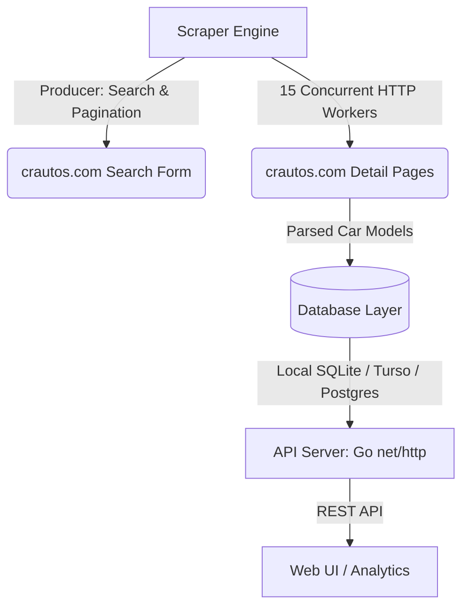

# CrautosDB - Codebase Improvements & Architecture Guide

Last Updated: 2026-11-12

This document tracks architectural, performance, security, and maintainability improvements for the **CrautosDB** application (Scraper, API, Database, and Web Frontend). It complements [ux-improvements.md](./ux-improvements.md), which covers frontend/product features and UX polish.

---

## Table of Contents
1. [Architecture Overview & Status](#1-architecture-overview--status)
2. [Completed Improvements](#2-completed-improvements)
3. [Remaining Optional Enhancements (Backlog)](#3-remaining-optional-enhancements-backlog)
4. [Implementation Roadmap & Status](#4-implementation-roadmap--status)

---

## 1. Architecture Overview & Status

CrautosDB is a Go-based system that scrapes vehicle listings, stores them in SQLite / Turso / PostgreSQL, and exposes an API server and analytical web interface.

---

## 2. Completed Improvements

### ✅ Migration of Detail Scraping & Backfill to Fast HTTP + `goquery`
* **Previous State:** 4 Selenium WebDrivers (Chrome processes) scraped individual car detail pages, accumulating V8 heap bloat until crashing (`0xc000013a`).
* **Current State:**
  * Replaced Chrome detail scraping with **15 concurrent HTTP worker goroutines** using Go's `net/http` and `github.com/PuerkitoBio/goquery`.
  * Replaced Seller Backfilling with **20 concurrent HTTP worker goroutines**.
  * Memory footprint dropped from **>4 GB to ~20 MB** and scraping speed increased by **~20x–30x**.

### ✅ Pure HTTP Search Producer (100% Elimination of Selenium & ChromeDriver)
* **Previous State:** The search producer relied on ChromeDriver for search forms and pagination, requiring bundled `chromedriver.exe` binaries (~20 MB) and headless Chrome.
* **Current State:**
  * Replaced Selenium search producer with direct HTTP POST requests to `searchresults.cfm?p=N` and `goquery` pagination parsing.
  * Removed `github.com/tebeka/selenium` and all ChromeDriver dependencies completely.

### ✅ Database Batching & Multi-Row Upserts (`UpsertCarBatch`)
* **Previous State:** Scraped cars were upserted serially one by one over HTTP/WebSocket to Turso (`libsql://`), incurring 50–150 ms per network round-trip.
* **Current State:**
  * Added `UpsertCarBatch` in `db/queries.go` performing multi-row SQL upserts chunked into 25 records per query (with `recordPriceChanges` tracking in `price_history`).
  * Buffered result collector in `scraper/scraper.go` (25-car batches + 2s ticker flush + individual-retry fallback), reducing remote write latency by ~90–95%.

### ✅ Security: Cloud Run Secret Manager & Local `.env` Autoload
* **Current State:**
  * Production deployments (`deploy_gcp.ps1` with `-SyncSecrets` and `cloudbuild.yaml`) inject `DATABASE_URL` and `OPENROUTER_API_KEY` via Google Cloud Secret Manager (`--set-secrets`) instead of plaintext environment flags.
  * Local development uses stdlib `loadDotEnv(".env")` in `main.go` (without overwriting existing env vars or Secret Manager values), with [.env.example](../.env.example) as template and `.env` / `.env.*` ignored in [.gitignore](../.gitignore).

### ✅ Startup Optimization: Opt-In `CleanUpData` (`-cleanup` Flag)
* **Current State:**
  * Removed the automatic full-table `CleanUpData()` scan from `db.Init()` (`db/db.go`) for instant API and test startup.
  * Exposed cleanup on demand via the `-cleanup` CLI flag in `main.go` (default `false`).
  * Added fast SQL pre-cleanup for placeholder comments (`'-'`, `'--'`, `'---'`, `'.'`, `' '`) and explicit `rows.Close()` before opening the update transaction so SQLite's single-connection pool never deadlocks.

### ✅ Database Connection Pooling (`sql.DB`) & Composite Indexes
* **Current State:**
  * Configured driver-aware `sql.DB` pool limits in `db/db.go` (`Init`):
    * Remote drivers (`postgres`, `libsql`): `SetMaxOpenConns(25)`, `SetMaxIdleConns(10)`, `SetConnMaxLifetime(5m)`, `SetConnMaxIdleTime(2m)`.
    * Local `sqlite`: `SetMaxOpenConns(1)`, `SetMaxIdleConns(1)`, and `PRAGMA busy_timeout=5000` (keeping `:memory:` databases alive in tests and preventing `SQLITE_BUSY` under concurrent writes).
  * Added composite and latency indexes in `schema`: `idx_cars_active_brand_year`, `idx_cars_active_price`, `idx_cars_active_scraped`, and `idx_cars_last_seen`.

### ✅ In-Memory TTL Cache for Filter & Stats Endpoints
* **Current State:**
  * Implemented thread-safe 5-minute TTL caching in `api/cache.go` (`serverCache` on zero-value-safe `api.Server`) for `/api/brands`, `/api/provinces`, `/api/sellers/top`, `/api/stats` (consolidating the 3 car-count queries into one SQL scan), and `/api/stats/detailed`.
  * `HandleRecordVisit` increments `statsVisits` directly via `incrementCachedVisits()` so visit counts reflect immediately without invalidating cached catalog aggregates.
  * Complements the 15-minute `MarketIndex` cache in `api/market.go`.

### ✅ Standardized JSON Error Responses
* **Current State:**
  * Replaced raw `http.Error(...)` calls across `api/handlers.go`, `api/deals.go`, and `api/price_history.go` with `respondError(w, code, message)` returning `{"error", "code"}` and `Content-Type: application/json`, keeping internal DB/HTTP errors strictly in server logs.
  * Deferred SSE headers (`text/event-stream`) in `HandleAICompare` until streaming actually begins so pre-stream OpenRouter failures return clean JSON errors, and updated `compareWithAI` in `web/src/api/client.js` to extract `parsedErr.error`.

### ✅ Graceful HTTP Server Shutdown
* **Current State:**
  * Replaced blocking `http.ListenAndServe` in `main.go` with `signal.NotifyContext(context.Background(), os.Interrupt, syscall.SIGTERM)` and `&http.Server{ReadHeaderTimeout: 10s, IdleTimeout: 120s}` calling `Shutdown` with a 10-second drain timeout (while avoiding a short `WriteTimeout` so SSE streams on `/api/ai/compare` remain uninterrupted).

### ✅ Multi-Stage Alpine `Dockerfile`, CI Format/Lint Gate & Unit Tests
* **Current State:**
  * Multi-stage Alpine [Dockerfile](../Dockerfile) runs `npm run lint` (`eslint .`), `npm run build`, and `gofmt -l main.go api db scraper cmd` before building a minimal static Linux binary without Chrome/ChromeDriver.
  * Automated unit test coverage across `scraper/` (`scraper_test.go`), `db/` (`db_optimizations_test.go`, `count_cars_test.go`, `market_test.go`, `market_flags_test.go`, `price_history_test.go`, `queries_test.go`), and `api/` (`cache_errors_test.go`, `deals_test.go`, `price_history_test.go`).

---

## 3. Remaining Optional Enhancements (Backlog)

### A. Context Propagation into Scraper Worker Loops (`Partial`)
* **Location:** `main.go`, `scraper/scraper.go`, `db/queries.go`
* **Gap:** HTTP server shutdown is graceful, but `scraper.Run()` and its worker goroutines still use blocking `http.Get`/`http.PostForm` and `d.Query`/`d.Exec` without accepting a `ctx context.Context`.
* **Next Step:** Pass the `signal.NotifyContext` down into `scraper.NewScraper` / `Run(ctx)` and switch detail/search requests to `http.NewRequestWithContext` so `SIGINT`/`SIGTERM` cleanly cancels in-progress scrapes and flushes pending batches.

### B. Offline HTML Detail Fixture Tests (`Partial`)
* **Location:** `scraper/scraper_test.go`
* **Gap:** Title, price, and mileage parsing helpers are unit tested, whereas full detail HTML extraction (`scrapeUsedCarHTTP`) is not yet covered with saved HTML fixtures.
* **Next Step:** Add representative saved HTML fixtures + `httptest.Server` tests to catch upstream `crautos.com` DOM layout changes offline.

### C. Automated `go test` & `golangci-lint` in CI (`Partial`)
* **Location:** [Dockerfile](../Dockerfile) / [cloudbuild.yaml](../cloudbuild.yaml)
* **Gap:** Cloud Build already enforces `npm run lint` and `gofmt -l`, but does not yet run `go test -count=1 ./...` or `golangci-lint` before producing the image.
* **Next Step:** Add `go test -count=1 ./...` (and optional `golangci-lint`) as a CI verification step before image push.

---

## 4. Implementation Roadmap & Status

| Status | Feature / Task | Scope | Outcome |
| :---: | :--- | :---: | :--- |
| **Completed** | **Fast HTTP + `goquery` Workers** | Scraper | 20–30x faster scraping, ~20 MB RAM |
| **Completed** | **Pure HTTP Search Producer** | Scraper | Removes Selenium & ChromeDriver completely |
| **Completed** | **Batch DB Upserts (`UpsertCarBatch`)** | DB / Scraper | 90–95% reduction in remote DB write latency |
| **Completed** | **Secret Manager & Local `.env` Autoload** | Infra / App | Zero plaintext secrets in deploy scripts or VCS |
| **Completed** | **Connection Pooling (`sql.DB`) & Composite Indexes** | DB | Prevents connection exhaustion & speeds filtered queries |
| **Completed** | **Startup `CleanUpData` Optimization (`-cleanup`)** | DB / CLI | Instant application and test startup |
| **Completed** | **In-Memory TTL Cache for Filter & Stats API** | API | Sub-millisecond static/stats responses + live visit counter |
| **Completed** | **Standardized JSON Error Responses** | API / Web | Consistent `{"error", "code"}` responses without SQL leaks |
| **Completed** | **Graceful HTTP Server Shutdown** | Server | Clean `SIGINT`/`SIGTERM` request draining |
| **Completed** | **Unit Tests (Parsers, DB Optimizations, API Cache/Errors)** | Tests | Guards parser logic, pool/indexes, cache TTL, and JSON errors |
| **Partial (P3)** | **Scraper Context Propagation** | Scraper | Instant `Ctrl+C` / `SIGTERM` cancellation mid-scrape |
| **Partial (P3)** | **Offline HTML Detail Fixture Tests** | Scraper | Catch upstream `crautos.com` HTML structure changes |
| **Partial (P3)** | **Run `go test` / `golangci-lint` in CI** | CI/CD | Automated backend test gate in Cloud Build |
